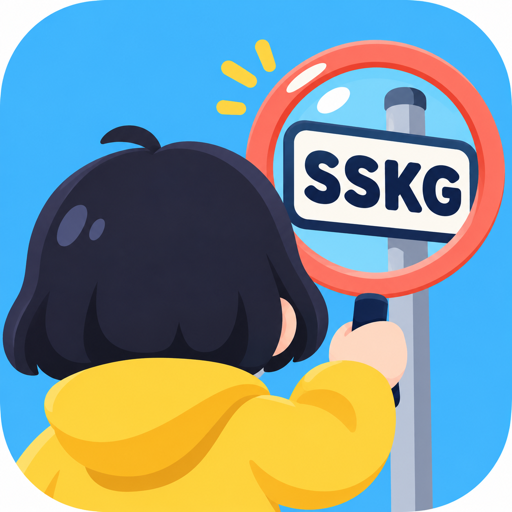

# SSKG — Sign South Korea Ganpan

**한국 여행자를 위한 한글 간판 학습 Android 앱**

SSKG는 한국을 방문하기 전이나 여행 중에 간판의 한글과 의미를 익힐 수 있도록 만든 앱입니다. 장소 이름, 교통 표지, 상점 안내처럼 여행자가 마주칠 만한 간판을 사진형 카드로 보여주고, 뜻과 발음을 함께 제공합니다. 학습자가 기억 여부를 직접 평가하면 그 결과를 다음 복습에 반영합니다.



> **프로젝트 상태:** 개발 중인 Android 앱입니다. 콘텐츠와 화면은 계속 개선하고 있으며, 배포 전 실기기·접근성 검증이 더 필요합니다.

## 프로젝트 배경

한글을 읽을 수 있어도 낯선 간판의 뜻을 바로 이해하기는 어렵습니다. SSKG는 단어를 목록으로 암기하는 대신, 간판이 놓인 거리와 장소의 맥락을 함께 보여주는 방식으로 이 문제에 접근했습니다. 학습한 표현을 실제 여행에서 알아보고 활용할 수 있게 하는 것이 목표입니다.

학습 콘텐츠에는 실제 장소를 바탕으로 제작한 **생성 이미지**가 포함됩니다. 모든 이미지가 현장에서 직접 촬영한 사진은 아닙니다.

## 주요 기능

| 기능 | 설명 |
|---|---|
| 간판 카드 학습 | 86개 간판 카드에서 이미지, 한글 표기, 번역, 단어 풀이, 장소 설명과 음성을 확인합니다. |
| 자기평가와 복습 | 카드를 왼쪽으로 넘기면 **Got it**, 오른쪽으로 넘기면 **Review**로 기록합니다. 평가 결과와 복습 예정 시점을 다음 학습에 활용합니다. |
| 학습 현황 | 학습한 카드와 숙련도, 복습 예정 카드 등 학습 기록을 확인합니다. 중단한 세션도 이어서 학습할 수 있습니다. |
| 다국어와 프로필 | 영어·일본어·중국어 설명을 제공하며, 프로필과 앱 언어를 설정할 수 있습니다. |
| 여행 도우미 | 여행 중 유용한 질문과 표현을 살펴보고, 관광 안내·긴급 연락처로 이동할 수 있습니다. |
| 간판 사진 저장 | 여행 중 발견한 간판을 직접 촬영해 기기에 보관하고 다시 볼 수 있습니다. |
| 오프라인 학습 | 기본 콘텐츠와 학습 기록을 기기에 보관해 네트워크 연결 없이도 핵심 학습을 이어갈 수 있습니다. |

## 학습 경험과 설계

**간판과 의미를 연결하는 카드.** 한글 표기만 보여주는 대신 이미지, 뜻, 단어 풀이, 발음과 짧은 설명을 함께 배치했습니다. 사용자는 글자를 읽는 연습과 함께 그 표현이 쓰이는 맥락을 익힐 수 있습니다.

**평가가 다음 복습으로 이어지는 구조.** `Review`로 평가한 카드는 다음 날 복습하도록 예약하고, `Got it`을 반복한 카드는 복습 간격을 늘립니다. 학습 세션에는 복습이 필요한 카드와 다른 카드를 함께 구성해 이미 본 내용과 새로운 내용을 이어서 학습하도록 했습니다.

**여행 환경을 고려한 로컬 저장.** 카드 콘텐츠와 음성, 학습 기록과 설정을 기기에 두어 인터넷 연결이 불안정한 상황에서도 학습할 수 있도록 설계했습니다. 직접 촬영한 간판 사진도 기기에 저장합니다.

**프로토타입에서 Android 구현까지.** 화면 프로토타입을 바탕으로 PRD·SRS, 기능 명세, Android 구현 설계와 단계별 개발 계획을 작성했습니다. 이후 학습 흐름을 구현하고 실기기 QA에서 발견한 문제를 수정하며 화면과 상호작용을 개선했습니다.

## 기술 구성

| 영역 | 기술 |
|---|---|
| 앱 | Kotlin, Jetpack Compose, Material 3, Navigation 3 |
| 상태와 비동기 처리 | ViewModel, StateFlow, Kotlin Coroutines |
| 데이터와 설정 | Room, DataStore, Kotlinx Serialization |
| 플랫폼 기능 | Hilt, Coil, Media3, WorkManager |
| 검증 | JUnit, Compose UI Test, Android instrumentation, Android Lint, detekt |

경량 헥사고날 구조를 적용해 학습 규칙을 Android 프레임워크와 분리했습니다. `domain`에 세션 구성·복습 정책과 포트를 두고, `data`와 `platform`에서 저장소와 기기 기능을 연결합니다. 화면은 기능별 모듈로 나누고 `app`에서 의존성과 내비게이션을 조립합니다.

```text
app                 앱 진입점, 내비게이션, 의존성 조립
domain              학습·복습 규칙, 유스케이스, 포트
data                콘텐츠와 학습 데이터 저장
platform            Android 플랫폼 기능
designsystem        공통 테마와 UI 컴포넌트
feature-*           온보딩, 학습, 진행 현황, 설정 화면
test-support        공통 테스트 도구
```

## 테스트와 개선

세션 구성, 복습 정책, 저장 및 화면 흐름을 단위·계측 테스트로 검증하도록 구성했습니다. Samsung Galaxy S7(Android 8.0) 실기기 QA에서는 스와이프, 뒤로가기, 다국어 화면 등을 점검하고 발견된 문제를 수정했습니다. 당시 기록은 [실기기 QA 보고서](QA_REPORT.md)에서 확인할 수 있습니다. 기기 종류와 접근성 조건을 넓힌 추가 검증은 남아 있습니다.

## 로컬 실행

필요 환경:

- JDK 17
- Android SDK Platform 37 및 Build Tools 36.0.0
- 저장소 품질 검사 실행을 위한 Node.js 24 이상

`ANDROID_HOME`을 설정하거나 `local.properties`에 Android SDK 경로를 지정한 뒤 실행합니다.

```bash
# 디버그 APK 빌드
./gradlew :app:assembleDebug

# 빌드, 정적 분석, JVM 테스트 등 품질 검사
./gradlew qualityGate

# 연결된 기기 또는 API 26 이상 에뮬레이터에서 계측 테스트
./gradlew connectedDebugAndroidTest
```

## 관련 문서

- [제품 요구사항 및 소프트웨어 요구사항](docs/PRD-SRS.md)
- [기능 명세](docs/functional-specification.md)
- [Android 구현 설계](docs/android-implementation-design.md)
- [단계별 구현 계획](docs/android-implementation-plan.md)
- [실기기 QA 기록 및 남은 검증 항목](docs/phase44-device-qa.md)

기획·설계 문서는 작성 시점의 요구사항을 담고 있어 현재 구현과 일부 차이가 있을 수 있습니다. 현재 콘텐츠 구성은 [콘텐츠 매니페스트](assets/content/manifest.json)를 참고하세요.
