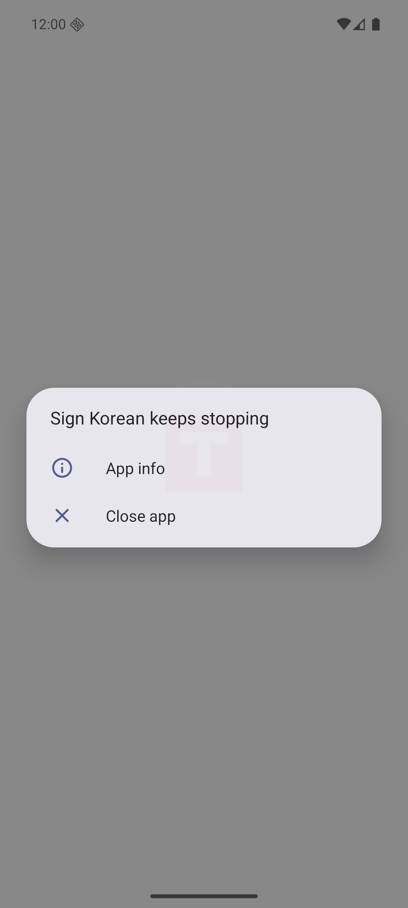
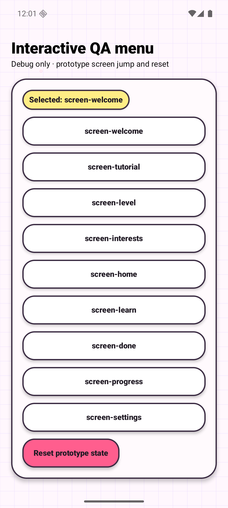
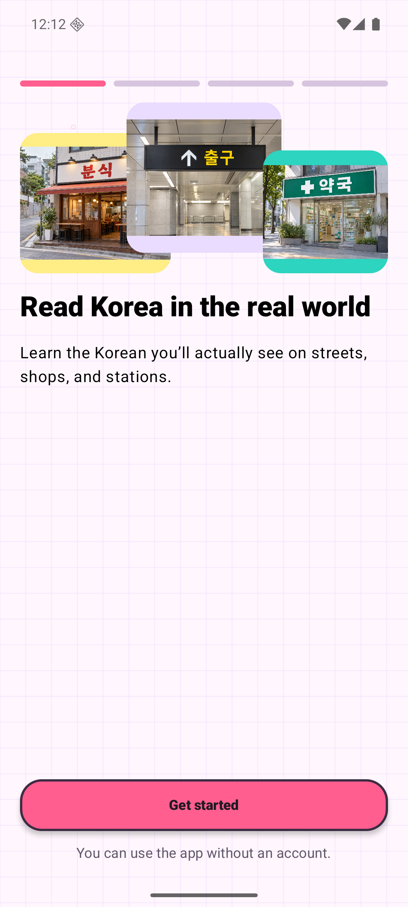

# 시뮬레이터 QA 보고서

- 실행일: 2026-10-22 (Asia/Seoul)
- 대상: Sign Korean Android debug APK
- 환경: Android Emulator `SignKorean_API_36` (API 36, arm64)
- 범위: 앱 설치·실행, 사용자 화면 진입, 화면별 스크린샷, 문구/현지화, 버튼 동작, 지원 언어 검증
- 초기 QA 중 코드 변경: 없음
- 현재 상태: **P0 실행 차단 이슈 수정 및 재검증 완료**

## 요약

앱이 첫 사용자 화면을 그리기 전에 종료되는 **P0 실행 차단 이슈**를 발견했다. 따라서 사용자용 모든 화면의 스크린샷, 문구/현지화, 모든 버튼 및 지원 언어 검증은 실행할 수 없었다.

## 수행 내역

1. Android Emulator를 부팅했다.
2. `:app:installDebug` 빌드·설치를 완료했다.
3. 기본 런처 활동(`MainActivity`)을 실행했다.
4. 앱이 즉시 종료되며 시스템 크래시 대화상자가 표시되는 것을 확인했다.
5. debug 전용 Interactive QA 메뉴를 실행하고 `screen-welcome` 버튼을 눌렀다.
6. 해당 버튼 역시 `MainActivity`로 전환하려다 동일한 실행 예외로 실패하는 것을 로그로 확인했다.

## 증거

### 기본 실행 실패

- 스크린샷: [02-launch-crash.png](02-launch-crash.png)
- 관찰 결과: `Sign Korean keeps stopping` 시스템 대화상자가 표시되었다.

### Debug QA 메뉴 및 화면 진입 시도

- 스크린샷: [04-debug-qa-menu-rendered.png](04-debug-qa-menu-rendered.png)
- 메뉴의 `screen-welcome` 버튼을 실제로 선택했다. 이 경로는 `MainActivity`를 열도록 구현되어 있으며, 동일한 크래시가 재현되었다.
- 버튼 조작 뒤 화면: [05-welcome-button-result.png](05-welcome-button-result.png)

## 결함

| 항목 | 내용 |
| --- | --- |
| 중요도 | **P0 — 앱 실행 불가** |
| 사용자 영향 | 앱이 첫 화면에 도달하지 못하므로 신규 사용자와 기존 사용자가 모든 핵심 기능을 사용할 수 없다. |
| 재현 절차 | 1) debug APK 설치 2) 앱 아이콘 실행 또는 `MainActivity` 실행 3) 앱 종료 및 시스템 크래시 대화상자 확인 |
| 런타임 근거 | `java.lang.IllegalStateException: You need to use a Theme.AppCompat theme (or descendant) with this activity.` |
| 원인 | `MainActivity`는 `AppCompatActivity`를 상속하지만, `Theme.SignKorean`은 Android 플랫폼의 `Theme.Material.*`을 상속한다. |
| 고쳐야 할 대상 | `app/src/main/res/values/themes.xml`, `app/src/main/res/values-night/themes.xml`, `app/src/main/java/com/signkorean/app/MainActivity.kt` |
| 수정 방향 | `MainActivity`를 유지한다면 day/night 모두 `Theme.SignKorean`을 `Theme.AppCompat` 하위 테마로 통일한다. 대안으로 Compose 전용 `ComponentActivity`로 전환할 수 있으나, 로케일 등 AppCompat 의존성을 함께 검토해야 한다. |
| 완료 기준 | 일반 실행과 Debug QA의 각 화면 진입이 크래시 없이 사용자 화면을 표시한다. |

## 미실행 항목과 사유

| 검증 항목 | 상태 | 사유 |
| --- | --- | --- |
| 사용자 화면별 스크린샷 | 미실행 | 앱이 첫 사용자 화면 전에 종료됨 |
| 모든 사용자 버튼 동작 | 미실행 | 사용자 화면에 진입 불가 |
| 문구 오류 및 자연스러운 현지화 | 미실행 | 사용자용 문구를 렌더링하지 못함 |
| 지원 언어 전환 및 언어별 문구 검증 | 미실행 | 앱 실행 불가 |

`locales_config.xml`에는 영어(`en`)와 일본어(`ja`)가 선언되어 있다. 그러나 실제 사용자 화면을 열 수 없었으므로 어느 언어도 현지화 품질 또는 레이아웃 관점에서 통과 판정을 내리지 않았다.

## QA 재개 조건

### 수정 및 재검증 결과

- 수정: `Theme.SignKorean`이 `AppCompatActivity`와 호환되는 `Theme.AppCompat.*.NoActionBar` 하위 테마를 사용하도록 day/night 테마를 정합화했다.
- 빌드: `./gradlew :app:installDebug` 성공, 수정 APK를 동일 시뮬레이터에 설치했다.
- 일반 실행: `MainActivity`가 크래시 없이 환영 화면을 표시했다. [07-post-fix-main-launch.png](07-post-fix-main-launch.png)
- 이전 실패 경로: Debug QA 메뉴에서 `screen-welcome`을 다시 선택해도 환영 화면이 표시되고, `FATAL EXCEPTION` 및 `Theme.AppCompat` 예외가 로그에 없다. [08-post-fix-debug-welcome.png](08-post-fix-debug-welcome.png)

### 남은 QA 범위

P0가 해소됐으므로 아래 순서로 전체 QA를 재개할 수 있다.

1. 기본 실행 및 재실행 안정성 확인
2. 모든 사용자 화면을 캡처
3. 화면에 표시되는 모든 버튼과 제스처를 실제로 수행
4. 영어와 일본어에서 모든 화면의 문구, 줄바꿈, 잘림, 의미 및 자연스러운 현지화를 확인
5. 실패 항목마다 중요도, 근거 스크린샷, 설명, 수정 대상 및 수정 방향을 기록
